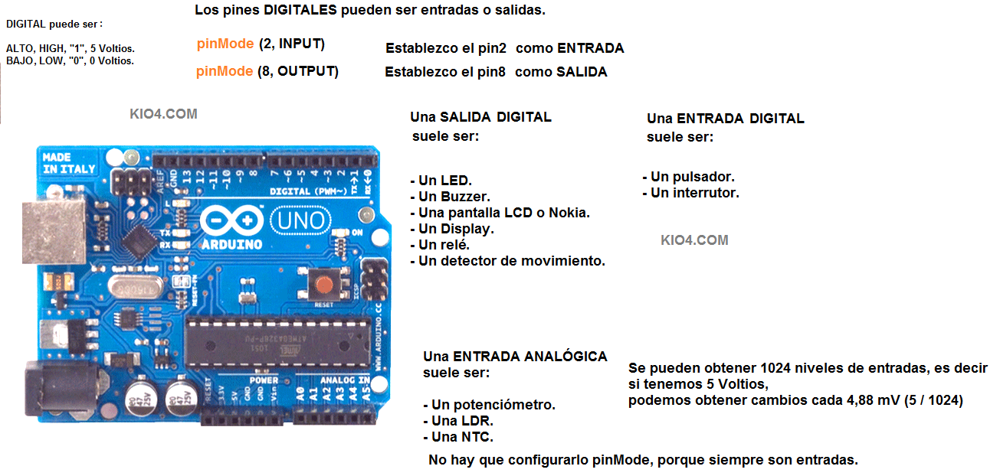
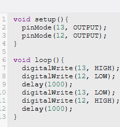
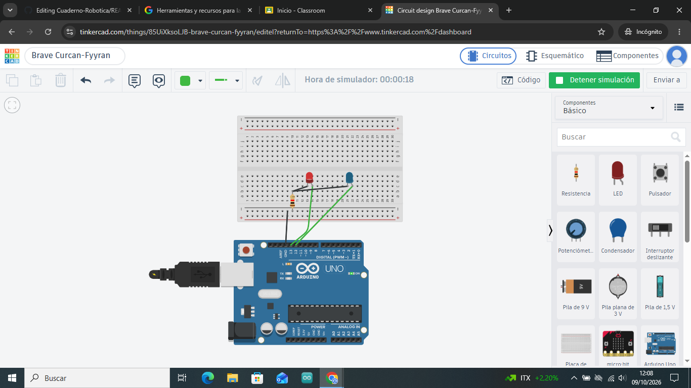
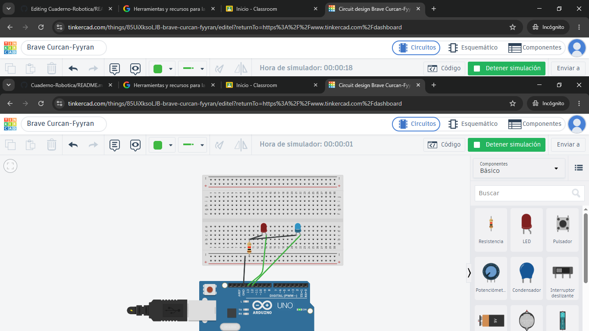
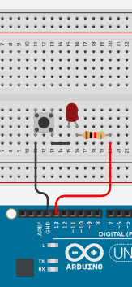
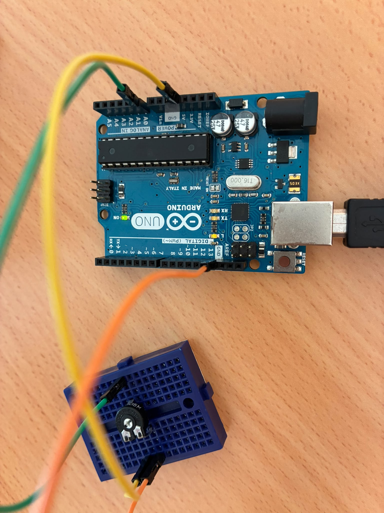

# PLACA ARDUINO UNO

Este reto consiste en conseguir que un led se encienda primero mientras el otro permanezca apagado y así sucesivamente.

void setup(): se ejecuta una sola vez al iniciar el programa y configura los pines 13 y 12 como salidas.
void loop(): repite continuamente las instrucciones.
digitalWrite(13, HIGH): enciende el LED del pin 13.
digitalWrite(12, LOW): apaga el LED del pin 12
delay(1000): espera 1 segundo.

Después,el LED del pin 13 se apaga y el del pin 12 se enciende,y vuelve a esperar 1 segundo.

## PULSADOR.

Este resto consiste en hacer que se encienda el led cuando presionemos el pulsador.

CODIGO:al principio del todo, he colocado las distintas variables que necesitaba para la práctica, siempre se ponen antes del void setup. Posteriormente, he puesto el void setup, declarando los pines de cada uno de los componentes. Después, el void loop, en el que lo primero que tenemos que poner es el digitalRead, para que esté todo el rato leyendo los valores del pulsador, y que lo meta en la variable pulsadorlectura. Para finalizar, colocamos dos if, uno que explica que, si el pulsador se encuentra en LOW, los diodos deben estar encendidos, y otro que es al revés. Después, ponemos nuestras correspondientes llaves y el programa está finalizado. Debemos empezar ya a tabular, que consiste en diferenciar qué parte del programa va con cual, insertando espacios.

MONTAJE:
  *Cables
  *Una resistencia
  *Un diodo LED
  *Un pulsador

El pulsador permite abrir o cerrar el circuito depende del tipo que sea. En este caso es pull UP, asique se cierra el circuito cuando se pulsa. Y mientras no se pulse, un muelle abre el circuito evitando la corriente.

BOTON sin PULSAR.

## POTENCIOMETRO MONITOR SERIE.

__int P2 = A2;__

__float valor = 0;__

__float deceroauno;
void setup() {
   Serial.begin(9600);
}__

__void loop() {
   valor = analogRead(P2);
   Serial.println(valor);
   delay(20);
}__

Este código de Arduino lee una señal analógica del pin A2 y muestra su valor en el Monitor Serie.
- int P2 = A2;: asigna el pin analógico A2 a la variable P2.
- float valor = 0;: crea una variable para guardar la lectura.
- float deceroauno;: declara una variable que no se utiliza.
- Serial.begin(9600);: inicia la comunicación con el ordenador.
- analogRead(P2);: lee el valor analógico del pin A2 (de 0 a 1023 en un Arduino Uno).
- Serial.println(valor);: muestra el valor leído.
- delay(20);: espera 20 milisegundos antes de repetir la lectura.

|Video|
|---|

|Resultado|
|---|
En el monitor serie de arduino empieza a verse los datos que detecta del potenciómetro conforme lo mueves:

## ULTRASONIDO.

# Reto 4: Mapeado de datos del potenciómetro
Este reto se basa en el anterior, solo se implementará la función del mapeado en el código para transformar los datos del potenciómetro (0-1023) a otros.

## Montaje
Es el mismo montaje que en el "Reto 3". Solo cambia el programa y la ejecución de los datos.

| Desde el lado | Desde arriba |
|----------|----------|
|||

## Programa.
1-Variable int. Esta variable sirve solamente para declarar el pin en el que se encuentra el potenciómetro, de ahí en nombre Pin-pot, "Pinpot".
2-Variable float. Esta servirá para guardar el valor que esté dando el potenciómetro, de ahí "valorpot".
3-Variable float. Esta será la variable que se imprimirá en el monitor serie ya que aquí guardaremos el valor del potenciómetro mapeado, de ahí "mapeopot".
En el "setup" tenemos la declaración del puerto serie a unos baudios más que suficientes.

El "loop" se usará básicamente para transformar el valor delpotenciómetro y ponerlo en el monitor serie, vamos línea por línea para que se entienda mejor:

1-Guardamos en la variable "valorpot" lo que se mida en el pin de la variable "Pinpot". Me explico, guarda la posiciñon del potenciómetro (que está conectado al pin A0) en la variable "valorpot".
2-Guardamos en la variable "mapeopot" el mapeo de 0-1023 a 0-100 del valor que hemos metido antes en la variable "valorpot". Mapear algo es básicamente convertir unos valores en otros, en este caso convertimos valores entre 0 y 1023 a 0 y 100.   Si tenemos el valor 0 se convierte en 0, si tenemos el 1023 se convierte en el 100, y así con todos los números del medio.
3-Ahora solo imprimimos en pantalla el valor resultante del mapeo.
4-Hacemos un pequeño delay para que nos dé tiempo a leer lo que hay en pantalla.

Resultado:
El resultado de esto es que conforme giramos el potenciómetro, va a ir saliendo en la pantalla los números desde 0 hasta 100 en vez de 0 a 1023.

## PWM
## Montaje:
En este montaje solo hay que añadir un diodo led y una resistencia al circuito de antes.

| Desde arriba | Desde el lado |
|----------|----------|
|  |  |

## Programa
1. int "Pinpot", esta declara, como en el programa anterior, el pin al que está conectado el potenciómetro.
2. int "Pinled", este, al igual que la anterior, declara el pin de un componente, pero en este caso es el de un led. Este led se debe encontrar en un pin digital especial, debe tener una virgulilla este pin, ya que estos pines tienen la característica de imitar pines analógicos. Y necesitamos esta función para poder modificar la intensidad de luz del diodo.
3. float "valorpot", esta tiene la misma función que en el reto anterior.
4. float "luminosidad", esta tiene la misma función que mapeopot en el reto anterior.

"setup":
1. Esteblecemos el pin del led en OUTPUT.
2. Ejecutamos el puerto serie.

 "loop":
1. Empezamos igual que en el reto anterior, metemos en "valorpot" lo que mide el pin del potenciómetro.
2. Mapeamos el valor del potenciómetro desde los valores suyos a los valores de 0 a 255 (los valores del diodo), y esto lo metemos en la variable de luminosidad.
3. Imprimimos en la pantalla el valor mapeado.
4. Activamos el pin del diodo con la intensidad del mapeo.
5. Un breve delay para poder leer la pantalla.

